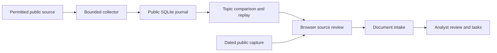
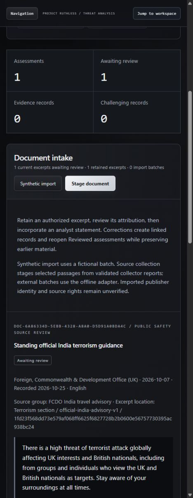

# RUTHLESS

A Node.js intelligence research workbench for preserving public-source reports, reviewing official India advisory changes and tracing analyst decisions.

RUTHLESS makes source passages, observation times and uncertainty inspectable. It is a research prototype: attack prediction, prevention effectiveness and agency readiness have not been validated.

## Implemented capabilities

- Fixed-source official India advisory collection with original-response preservation, SQLite persistence, topic comparison and opt-in hourly collection.
- First-observed historical replay, source hashes, bounded storage, retry backoff and source-bound review events.
- Document intake, assessments, verification tasks, corrections and review history.
- Five bounded browser public-source adapters and NASA public-media discovery; availability depends on upstream access.
- English/Hindi rule experiments, report-linkage evaluation and explicitly fictional 3D exercises. Their authored outcomes are not real predictive performance.

Main stack: dependency-free browser JavaScript, Node 24 and built-in SQLite. Optional local semantic inference has a separately pinned Transformers dependency; optional AI requires separate credentials and authorization.

## Quick start

Install **Node 24.22.1** and Git, then run from the repository root:

```sh
node scripts/serve-research.mjs
```

Open http://127.0.0.1:4181/#collection. Choose **Inspect retained public capture** for the genuine, dated October 24 capture without a network request. Choose **Connect local journal**, then **Collect due official source** to request a current observation. Network failures are reported without fabricated replacements. The collector starts with an empty local journal on a fresh clone. Monitoring and paid AI are disabled by default.

Stop with Ctrl+C. Public captures persist in the ignored `.intelligence-runtime/` directory. Reviewer notes there are plaintext. The separate encrypted workspace backend only accepts synthetic data. Browser workspace changes require explicit save; staging is not evidence approval.

## Verification

No npm installation is required for the main application:

```sh
node scripts/verify.mjs check
node scripts/verify.mjs test
node scripts/scan-secrets.mjs
```

The verification wrapper runs the complete test/check commands declared in package.json and propagates failures. Tests include local HTTP, persistence, integrity, cooldown, bounded parsing, historical replay and analytical regressions. Network adapters use authored protocol fixtures in automated tests; those tests do not prove current upstream availability. CI tests Ubuntu and Windows on pushes to main, pull requests and manual dispatch. See [.github/workflows/verify.yml](.github/workflows/verify.yml) and [CI evidence](CI_VALIDATION_REPORT.md); no static passing badges are used.

## Architecture



The UI and analytical tools are retained under `dist/` as maintained source, not disposable build output. Local services are under `collection/`, `backend/` and `scripts/`. Hosted static pages have no journal worker or paid AI service.

## Demonstration

The screenshot below is from the real October 24 local run, not a current incident prediction. It shows a retained official passage awaiting review. See [reproducible walkthrough](DEMO_VERIFICATION.md).



The existing Sites deployment requires owner sign-in; it is not a verified anonymous recruiter demo. Use the local quick start above.

## Limits and security

Single-user loopback services are not suitable for public backend hosting. The public-data journal lacks authenticated reviewer identity, RBAC, encryption and external audit anchoring. Local integrity checks cannot defeat privileged full-database replacement. Do not load classified data or private personal records. See [SECURITY.md](SECURITY.md) and [security review](SECURITY_REVIEW.md).

No full-internet crawling, social-profile aggregation, CCTV integration or autonomous enforcement is implemented. No independent incident labels support accuracy, false-alarm, missed-incident or prevention claims. The optional semantic experiment is not part of the core zero-dependency test guarantee. No throughput or scalability benchmark is claimed.

## Documentation and ownership

- [Detailed existing workbench guide](README-WORKBENCH.md)
- [Engineering milestone and real-source findings](docs/ENGINEERING-MILESTONE-v0.30.md)
- [Architecture and interview learning guide](docs/ENGINEERING_GUIDE.md)
- [Readiness audit](PORTFOLIO_READINESS_AUDIT.md)
- [Publication checklist](PUBLICATION_CHECKLIST.md)
- [Contributing](CONTRIBUTING.md)

Development used AI-assisted tools. Repository quality does not establish the owner's independent interview proficiency. No open-source license has been selected; third-party content retains its own attribution and reuse conditions. Public publication awaits owner approval and unresolved licensing review.
